# Game Dev Agentic Skills
<div align="center">
  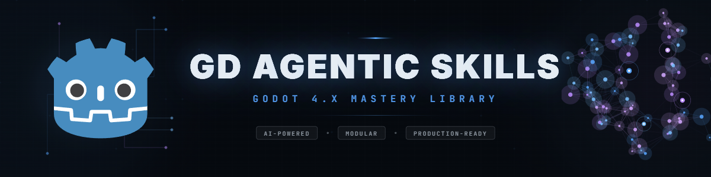

[](https://github.com/thedivergentai/Game-Dev-Agentic-Skills/stargazers)
[](LICENSE)
[](https://godotengine.org/)
[](https://bevyengine.org/)
[](skills_index.json)
[](https://github.com/thedivergentai/Game-Dev-Agentic-Skills/commits/main)
[](https://skills.sh/thedivergentai/Game-Dev-Agentic-Skills)

**Game Dev Agentic Skills (GDAS)** - agent library for **Godot 4.7+** and **Bevy 0.20+**

**"A skill forgotten is a power lost." — The Code Architect**

**Brought to you by [Divergent AI](https://github.com/thedivergentai)**

</div>

---

## 📜 Updates

<div align="center">
  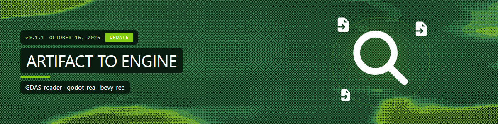
</div>

### v0.1.1 - Artifact to Engine
**October 16, 2026**

- **[gdas-reader](skills/gdas-reader/SKILL.md)**: reads a source tree, web bundle, asset folder, WASM module, or PE/ELF header into an evidence ledger. It is shared by both engines and is not part of either hub mirror.
- **[godot-rea](skills/godot-rea/SKILL.md)**: emits a Godot 4.7 stub project from that ledger. Unknown behavior stays `pass`.
- **[bevy-rea](skills/bevy-rea/SKILL.md)**: emits a Bevy 0.20 stub crate from the same ledger. Empty systems stay empty until a Domain Skill fills them.
- **License gate**: asset bytes are copied only when you pass a real license note and `--allow-assets`.

---

<details>
<summary><b>📜 Update Archive</b></summary>

<div align="center">
  
</div>

#### v0.1.0 - Bevy skills
**October 11, 2026**

- **Two engines**: Godot 4.7+ under **[godot-master](skills/godot-master/SKILL.md)** and Bevy 0.20+ under **[bevy-master](skills/bevy-master/SKILL.md)**, each with its own hub and Domain Skills.
- **Route by engine**: Godot work starts at godot-master. Bevy work starts at bevy-master. There is no singular product-wide master.
- **Bevy Domain Skills**: ECS ownership, rendering, gameplay, UI, platforms, and genre skills. Install one path at a time.

<div align="center">
  
</div>

#### v0.0.11 — Agent Eyes
- **500 stars** — thank you. That puts this repo in roughly the **top 0.4%** of all public GitHub repositories.
- **New — [godot-agent-vision](skills/godot-agent-vision/SKILL.md)**: agents get **eyes** — capture GUI / assets / editor viewports to budgeted WebP, then score what they see against a granular production rubric (typography-weighted, anti-slop, identity).
- Cross-platform host CLI (Win / macOS / Linux) + TEMP editor bridge under `.gdskills/` — not an in-game Autoload.

<div align="center">
  
</div>

#### v0.0.10 — Version Station
- **Version Station**: New Architecture skill - [godot-version-migration](skills/godot-version-migration/SKILL.md) - full-history engine upgrades from early Godot through **4.7** (legacy eras, official 3 to 4, then hop-by-hop 4.x).
- **Per-skill version notes**: Every Domain Skill ships `references/migration-notes.md`; Domain `SKILL.md` bodies stay on **current** APIs.
- **Routing**: Analyst, Auditor, Builder, foundations, GDScript, and TileMap point engine-version work at that hub; `godot-master` routes upgrades there.

<div align="center">
  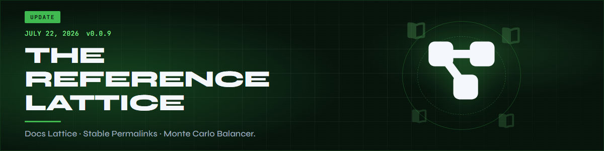
</div>

#### v0.0.9 — The Reference Rail Update
- **The reference rail**: Every Domain Skill now ends with curated official documentation (`docs.godotengine.org/en/stable/`) plus Related Skills (Prerequisites / Complements / Downstream / Master), so agents can research deeper without leaving the skill graph.
- **Script and reference footers**: Research-link comment blocks on Domain Skill scripts and reference notes (marker `GDSkills research links (agents)`) - non-executing, file-specific, progressive disclosure.
- **SPECIAL MENTION —** <a href="https://github.com/DedInc"></a> [**@DedInc**](https://github.com/DedInc): First external Domain Skill — [godot-monte-carlo-balancer](skills/godot-monte-carlo-balancer/SKILL.md) — source-driven Monte Carlo balance lab (Rust + rayon), Resource-first extract, playstyle CI bands, economy careers, and headless Godot calibration. Thank you!

<div align="center">
  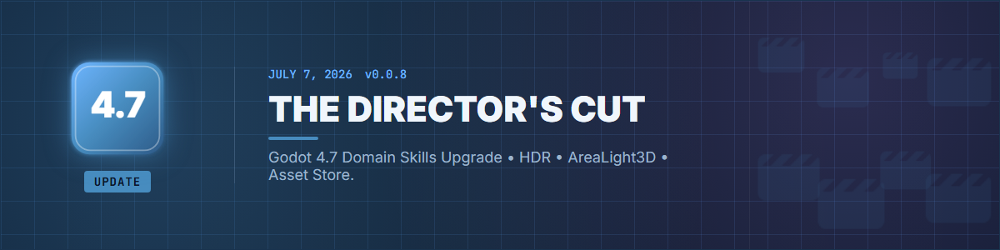
</div>

#### v0.0.8 — The Director's Cut Update
- **Godot 4.7 Director's Cut**: Full library upgrade to Godot 4.7+ - AreaLight3D, HDR output, Asset Store, built-in virtual joystick, and a version digest for 4.6 to 4.7 projects.
- **Domain Skills**: Renamed "Micro-Skills" to **Domain Skills** - 92 modular topic skills, each with a 4.7 baseline and targeted version deltas.
- **Persona Squad**: Anara, Aurelius, and Builder updated for 4.7 scoring, never-lists, and `GODOT_PATH` CLI overrides.

<div align="center">
  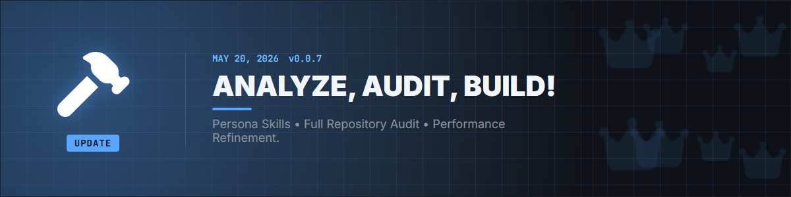
</div>

#### v0.0.7 — The Analyze, Audit, Build! Update
- **Three Persona-Based Skills**: We introduced specialized agent skills for `@godot-analyst` (Anara), `@godot-auditor` (Aurelius), and `@godot-builder` to streamline and unify our persona development and code optimization workflows.
- **MCP Clean-up & Direct Building**: Defunct `MCP Setup` and `MCP Builder` skills have been removed; we now use Auditor and Builder to construct and compile projects directly via the Godot CLI, maximizing native efficiency.
- **Full Skills Audit**: Completed a comprehensive and rigorous audit of all microskills to elevate the knowledge depth and execution quality to the highest agentic standard.
- **Lead Architect Sync**: Synchronized all audited advancements with the central `godot-master` hub, making the orchestrator smarter, faster, and more robust.

<div align="center">
  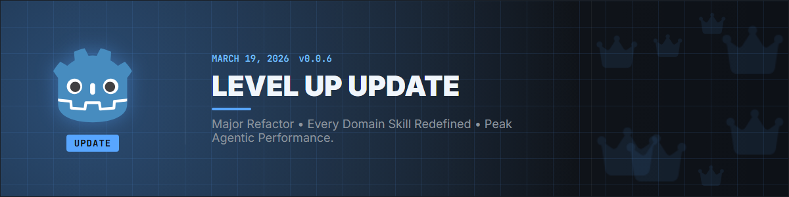
</div>

#### v0.0.6 — The Expert Augmentation & Master Orchestration Update
- **Microskill Overhaul**: We spent many hours updating *all* microskills to contain top expert-level knowledge, directly extracted from the Godot documentation. This massive update ensures all resources are true to the current engine state, empowering developers with best practices and reducing AI slop.
- **Godot Master Takes Control**: We updated the `godot-master` skill to fully orchestrate and integrate this major skill update. It is now a true, all-in-one Godot Master skill!
- **Feedback Requested**: We'd love your feedback on the new updates! The easiest way to share your thoughts is to [open an issue or start a discussion on our GitHub](https://github.com/thedivergentai/Game-Dev-Agentic-Skills/issues).

<div align="center">
  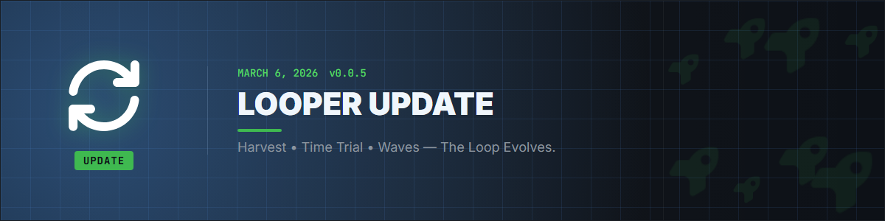
</div>

#### v0.0.5 — The Looper Update
- **Resource Harvesting**: Introduced `godot-game-loop-harvest` for interactive gathering, node depletion, and rarity-based drop tables.
- **Time Trials & Ghosts**: Added `godot-game-loop-time-trial` with precise millisecond timing and ghost transform recording/playback.
- **Wave-Based Survival**: Implemented `godot-game-loop-waves` for round-based difficulty scaling and dynamic enemy pool management.


<div align="center">
  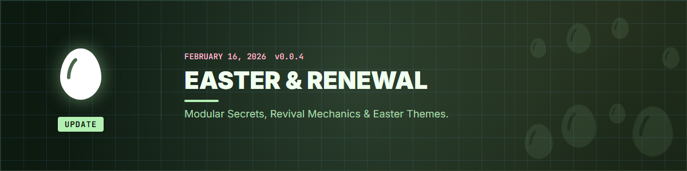
</div>

#### v0.0.4 — The Easter & Renewal Update
- **Seasonal Theming Identity**: Introduced `godot-theme-easter` for safe, runtime aesthetic injection (StyleBox duplication & material swapping).
- **Core Loop Expansion**: Added `godot-game-loop-collection` for volumetric procedural spawning and `godot-mechanic-revival` for "Souls-like" mortality.
- **Interaction Secrets**: Implemented `godot-mechanic-secrets` for input sequence buffering (Konami code) and hidden discovery persistence.


<div align="center">
  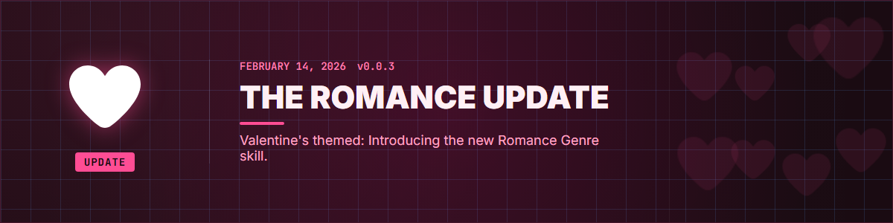
</div>

#### v0.0.3 — The Romance Update
- **New Genre Mastery**: Introduced the comprehensive [Romance & Dating Sim](skills/godot-genre-romance/SKILL.md) skill set.
- **Master Integration**: Unified the Romance skill into the [godot-master](skills/godot-master/SKILL.md) orchestration layer.
- **Production Scripts**: Added battle-tested GDScript patterns for affection tracking, relationship routing, and date events.

<div align="center">
  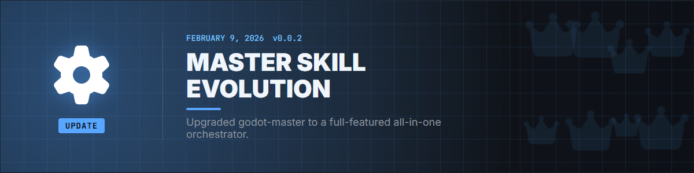
</div>

#### v0.0.2 — Master Skill Evolution
- **Unified Architecture**: Upgraded `godot-master` to an all-in-one orchestration layer for all 87 specialized skills.
- **Decision trees**: Integrated expert-level Godot 4 architectural decision trees and anti-pattern guides.
- **Workflow Scaffolding**: Added programmatic scene building and project initialization patterns.

<div align="center">
  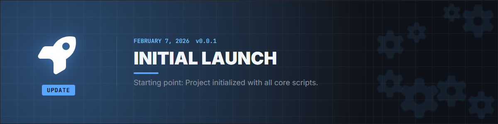
</div>

#### v0.0.1 — Initial Launch
- **The Foundation**: Released the initial library of 80+ Godot 4.x Agentic Skills.
- **Agent-First Design**: Established the DIA (Discovery-Ingestion-Application) loop for AI Coding Agents.
- **Core Systems**: Atomic implementations for 2D, 3D, UI, and Gameplay fundamentals.

</details>

---


## Engines

**Game Dev Agentic Skills** is one product with per-engine trees. Pick the master for the engine you are shipping — there is **no** singular product-wide master.

| Engine | Master | What you get |
| --- | --- | --- |
| **Godot 4.7+** | [godot-master](skills/godot-master/SKILL.md) | 99 Domain Skills, personas, workflows, production scripts |
| **Bevy 0.20+** | [bevy-master](skills/bevy-master/SKILL.md) | ECS hub plus 82 Domain Skills |

Install **one** engine master or **one** Domain Skill — never `--all`. Pick the engine you are shipping; skills stay engine-scoped.

## 📍 Quick Navigation

| 🚀 Get Started | 🟦 Godot Master | 🦀 Bevy Master | 🧩 Domain Skills | 🤖 Agent Protocol | ⭐ Star History |
|:---:|:---:|:---:|:---:|:---:|:---:|
| [Install](#-quick-start) | [Godot hub](#-godot-master---godot-hub) | [Bevy hub](#-bevy-master---bevy-hub) | [Godot skills](#godot-domain-skills) · [Bevy skills](#bevy-domain-skills) | [DIA Loop](#-for-agents--the-discovery-ingestion-application-protocol) | [Growth Chart](#-star-history) |

---

## The Philosophy

**Game Dev Agentic Skills (GDAS)** is an agent-first knowledge library for shipping real games — not AI slop. Each engine gets its own master and Domain Skills.

- **Godot 4.7+** is fully supported: doc-true patterns, personas, and production scripts under [godot-master](skills/godot-master/SKILL.md).
- **Bevy 0.20+** is fully supported: ECS ownership and Domain Skills under [bevy-master](skills/bevy-master/SKILL.md).
- Skills stay engine-scoped. Install one path so you do not trigger a Context Storm.

**If this project helps your development or empowers your agents, please give it a star! 🌟**

---

## ⚡ Quick Start

Choose **one** path so you do not trigger a **"Context Storm"** (flooding the agent with every skill at once).

### Path A: Godot
New Godot project, or an existing one that needs a **Godot 4.7+** standards check - install the Godot hub **or** one Godot Domain Skill:

```bash
npx skills add thedivergentai/Game-Dev-Agentic-Skills/skills/godot-master
# or one Domain Skill:
npx skills add thedivergentai/Game-Dev-Agentic-Skills/skills/godot-characterbody-2d
```

### Path B: Bevy
Bevy work starts at the Bevy hub **or** one Bevy Domain Skill:

```bash
npx skills add thedivergentai/Game-Dev-Agentic-Skills/skills/bevy-master
# or one Domain Skill:
npx skills add thedivergentai/Game-Dev-Agentic-Skills/skills/bevy-ecs-composition
```

### Path C: One specialist skill
Need a single feature and already know which skill owns it - install only that path (either engine):

```bash
npx skills add thedivergentai/Game-Dev-Agentic-Skills/skills/godot-inventory-system
npx skills add thedivergentai/Game-Dev-Agentic-Skills/skills/bevy-inventory-system
```

> [!DANGER]
> **NEVER** use the `--all` flag when installing this repository (e.g., `npx skills add ... --all`). That is an **"Instant No-No"** — it forces your agent to load every metadata entry across **184** skills and triggers an unrecoverable Context Storm.

---

## 🧭 Agent Installation Rubric

Use this when installing via the [skills CLI](https://github.com/vercel-labs/skills), or when an agent is reading this README after a **repo clone** (DIA path) instead of a normal plugin install.

| Agent | `-a` flag | Project path | Global path |
|:---|:---|:---|:---|
| Cursor | `cursor` | `.agents/skills/` | `~/.cursor/skills/` |
| Claude Code | `claude-code` | `.claude/skills/` | `~/.claude/skills/` |
| Codex | `codex` | `.agents/skills/` | `~/.codex/skills/` |
| Windsurf | `windsurf` | `.windsurf/skills/` | `~/.codeium/windsurf/skills/` |
| Gemini CLI | `gemini-cli` | `.agents/skills/` | `~/.gemini/skills/` |
| GitHub Copilot | `github-copilot` | `.agents/skills/` | `~/.copilot/skills/` |
| OpenCode | `opencode` | `.agents/skills/` | `~/.config/opencode/skills/` |

**Rules**
1. **Preferred install**: one path only, for example `npx skills add thedivergentai/Game-Dev-Agentic-Skills/skills/godot-master -g -a <agent> -y` or `npx skills add thedivergentai/Game-Dev-Agentic-Skills/skills/bevy-master -g -a <agent> -y` (swap the skill path for a Domain Skill when needed).
2. **Verify**: `npx skills list -g -a <agent>`
3. **Restart** the host agent after install — most agents load skills once at session start.
4. **Clone / DIA path** (no `npx skills add`): query [`skills_index.json`](skills_index.json), then read `skills/<name>/SKILL.md` with the agent's file tool. Do **not** hand-symlink into host skill dirs unless the user asks for that.
5. **Canonical store**: `~/.agents/skills/` is the CLI's shared copy; per-agent discovery paths differ by design.

### Troubleshooting
- Skill installed but missing in the agent → confirm with `npx skills list`, re-run with the correct `-a <agent>`, then restart the agent.
- Do **not** treat a manual Claude-only symlink into `~/.claude/skills/` as the default fix — that only helps one host.

---

## 🧠 Context Management: Performance Guidelines

To keep your AI agent fast and accurate, follow these "Expert Efficiency" rules:

### 1. The "Power of One" Rule
Either use an engine **master** (`godot-master` / `bevy-master`) OR individual **Domain Skills** — never both masters plus a pile of Domain Skills. 

*   **Godot Master** is an "Orchestrator" skill. It is dense (~15k tokens) but provides a complete blueprint. Use it when the "Big Picture" matters.
*   **Domain Skills** are "Surgical" skills (~2-5k tokens). They are fast, reliable, and keep the agent focused on one specific API.

### 2. Why "Install All" Fails
Installing 184 skills simultaneously creates a **"Metadata Flood"**:
- **Token Bleed**: ~15,000 tokens are "permanently" used just to tell the agent which skills exist.
- **Instruction Conflicts**: Having multiple overlapping expert instructions (e.g., 20+ different genre blueprints) can cause the agent to lose its specific focus.
- **Reasoning Lag**: The model has to sift through 100+ KB of text before deciding what to do.

### 3. Repository Clones vs. Plugin Installs
- **Plugin Install (`npx skills add`)**: Copies/links the skill into your agent's skill directory (see [Agent Installation Rubric](#-agent-installation-rubric)). The agent can then discover it automatically. This is why installing too many at once causes a "Context Storm."
- **Repository Clone**: If you merely clone this repo to a folder (e.g., `Downloads/GDSkills`), the agent will **NOT** auto-load skills unless you are working inside that directory. Use [`skills_index.json`](skills_index.json) + read each `SKILL.md` with the agent's file tool (DIA loop below).

---

<div align="center">
  
</div>

**[godot-master](skills/godot-master/SKILL.md)** is the hub for Godot 4.7+ projects. It orchestrates 99 Domain Skills, personas, workflows, and production scripts into one architectural framework. Install the hub or a single Domain Skill when you are shipping on Godot.

<details>
<summary><b>Explore Godot</b></summary>

## 🏆 Godot Master - Godot hub

**[godot-master](skills/godot-master/SKILL.md)** is the Godot hub. It orchestrates the Godot Domain Skills into one architectural framework for Godot 4.7+ projects. It does not route Bevy work. Bevy starts at [bevy-master](skills/bevy-master/SKILL.md).

### 🎯 What Makes Godot Master Special?

Unlike individual Domain Skills that focus on isolated features, **godot-master** is your *system architect*. It provides:

**📚 Comprehensive Knowledge Base**
- **100 Reference Documents**: Complete markdown guides for every skill, from foundations to advanced genres
- **982 Unique Production Scripts**: Battle-tested, production-ready GDScript implementations
- **11 Workflow Patterns**: Step-by-step architectural workflows (scaffolding, entity orchestration, persistence, optimization, multiplayer, Builder CLI scene builds, etc.)

**🧠 Expert Frameworks**
- **Architectural decision guide**: Choose the right pattern for your project (component-driven, event-driven, resource-streaming, deterministic networking)
- **15 Anti-Patterns**: Explicit "NEVER DO THIS" rules with non-obvious explanations (e.g., why `get_tree().root.get_node()` breaks, why `load()` in `_process` kills performance)
- **Performance Budgets**: Concrete numbers for mobile/desktop targets (draw calls, triangle counts, script time)
- **Server API Patterns**: Expert escape hatch for 10K+ entities using RenderingServer/PhysicsServer RIDs

**🏗️ The Layer Cake Architecture**

Godot Master enforces a signal-based separation of concerns:

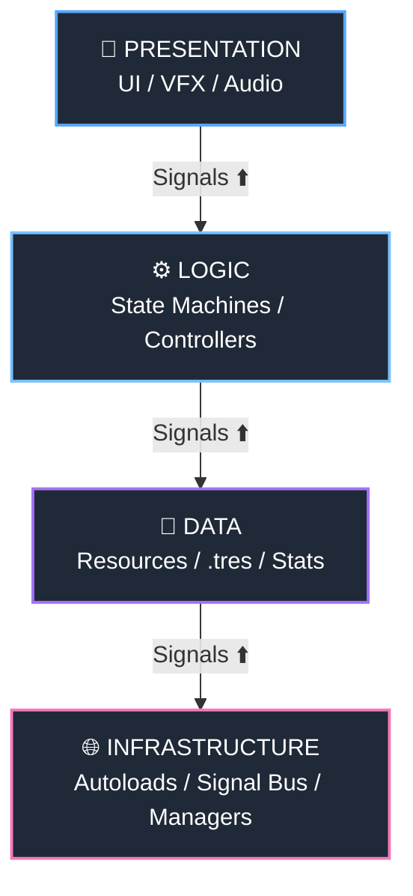

**Critical Rule**: Signals travel UP only. Presentation layer never modifies Data directly. Infrastructure speaks exclusively through signals.

### 🔄 When to Use Godot Master vs Domain Skills

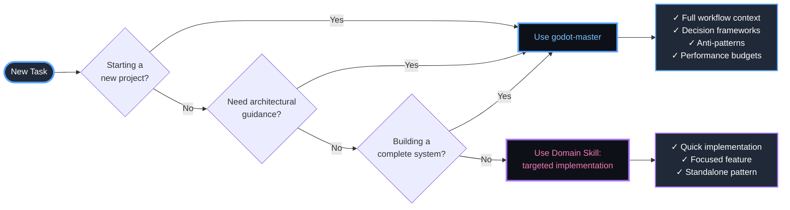

**Use godot-master when:**
- Starting a new Godot project from scratch
- **Auditing an existing project** to find anti-patterns or standards violations
- Designing game or application architecture
- Building entity/component systems
- Debugging performance or physics issues
- Choosing between 2D/3D approaches
- Implementing multiplayer
- Optimizing draw calls or script time
- Shipping the same design on more than one platform

**Use Domain Skills when:**
- Adding a specific feature to an existing codebase
- Learning a targeted Godot API pattern
- Implementing standalone functionality (UI component, particle effect, save system)

### 📖 Access Godot Master

```bash
# Skill path
skills/godot-master/SKILL.md

# Contains
├── 91 reference markdown files (references/)
├── 185 production scripts (scripts/)
└── Complete architectural decision trees
```


### GDAS-reader

**[gdas-reader](skills/gdas-reader/SKILL.md)** reads a source tree, web bundle, asset folder, WASM module, or PE/ELF header into an evidence ledger. It is shared by the Godot and Bevy reconstruction skills and mirrored inside both hubs.

### Godot Domain Skills

Godot Domain Skills are modular Godot 4.7+ modules. Install **[godot-master](skills/godot-master/SKILL.md)** or one skill below. 99 Domain Skills sit with the hub.

<details>
<summary><b>Architecture & Foundation (15 skills)</b></summary>

- **[godot-analyst](skills/godot-analyst/SKILL.md)**: Anara - visionary scoring and certification for Godot 4.7+ architecture
- **[godot-auditor](skills/godot-auditor/SKILL.md)**: Aurelius - never-list enforcement and architectural audit for Godot 4.7+
- **[godot-autoload-architecture](skills/godot-autoload-architecture/SKILL.md)**: Singleton patterns, global state management, signal-based communication
- **[godot-builder](skills/godot-builder/SKILL.md)**: Headless CLI scene scaffolding and build orchestration
- **[godot-composition](skills/godot-composition/SKILL.md)**: Entity-Component architecture for scalable game systems (NPCs, weapons, actors)
- **[godot-composition-apps](skills/godot-composition-apps/SKILL.md)**: Composition patterns for applications and tools (UI-focused)
- **[godot-debugging-profiling](skills/godot-debugging-profiling/SKILL.md)**: Print debugging, breakpoints, profiler, memory leak detection
- **[godot-gdscript-mastery](skills/godot-gdscript-mastery/SKILL.md)**: Static typing, signal architecture, unique nodes, style guide
- **[godot-project-foundations](skills/godot-project-foundations/SKILL.md)**: Feature-driven folder structure, project scaffolding, conventions
- **[godot-rea](skills/godot-rea/SKILL.md)**: Emit a Godot 4.7 stub project from a GDAS-reader ledger
- **[godot-project-templates](skills/godot-project-templates/SKILL.md)**: Base `.gitignore`, export presets, input maps
- **[godot-resource-data-patterns](skills/godot-resource-data-patterns/SKILL.md)**: `.tres` workflows, data-driven design, resource factories
- **[godot-signal-architecture](skills/godot-signal-architecture/SKILL.md)**: Global vs scoped signal buses, signal-driven decoupling
- **[godot-state-machine-advanced](skills/godot-state-machine-advanced/SKILL.md)**: Hierarchical FSMs, pushdown automata, state stacks, transition validation
- **[godot-version-migration](skills/godot-version-migration/SKILL.md)**: Full-history engine upgrades (legacy eras → 3→4 → 4.x hops) with per-skill migration notes

</details>

<details>
<summary><b>World, Rendering & Animation (18 skills)</b></summary>

- **[godot-2d-animation](skills/godot-2d-animation/SKILL.md)**: `AnimatedSprite2D`, skeletal cutout rigs, procedural animation
- **[godot-2d-physics](skills/godot-2d-physics/SKILL.md)**: Collision layers/masks, `Area2D` triggers, raycasting, `PhysicsDirectSpaceState2D`
- **[godot-animation-player](skills/godot-animation-player/SKILL.md)**: Timeline animations, track types, root motion, RESET tracks
- **[godot-animation-tree-mastery](skills/godot-animation-tree-mastery/SKILL.md)**: `AnimationTree`, `StateMachine`, `BlendSpace2D`, layered animations
- **[godot-camera-systems](skills/godot-camera-systems/SKILL.md)**: Smooth following, camera shake, trauma system, deadzone logic
- **[godot-characterbody-2d](skills/godot-characterbody-2d/SKILL.md)**: Platformer movement (coyote time, jump buffer), collision handling
- **[godot-particles](skills/godot-particles/SKILL.md)**: `GPUParticles2D/3D` vs `CPUParticles`, visibility AABB, particle effects
- **[godot-shaders-basics](skills/godot-shaders-basics/SKILL.md)**: `CanvasItem` shaders, post-processing, parameter animation
- **[godot-tilemap-mastery](skills/godot-tilemap-mastery/SKILL.md)**: `TileMap`, autotiling, chunking, runtime modification
- **[godot-tweening](skills/godot-tweening/SKILL.md)**: `Tween` API, juice/game feel, easing functions
- **[godot-3d-lighting](skills/godot-3d-lighting/SKILL.md)**: `DirectionalLight3D`, shadow cascades, `VoxelGI` vs `SDFGI`, `LightmapGI`
- **[godot-ai-navigation](skills/godot-ai-navigation/SKILL.md)**: Chase, patrol, and crowd choices on NavigationAgent / NavigationServer
- **[godot-3d-materials](skills/godot-3d-materials/SKILL.md)**: `StandardMaterial3D`, PBR workflows, ORM textures, transparency modes
- **[godot-3d-world-building](skills/godot-3d-world-building/SKILL.md)**: `GridMap`, `CSG` geometry, `WorldEnvironment`, volumetric fog
- **[godot-navigation-pathfinding](skills/godot-navigation-pathfinding/SKILL.md)**: `NavigationAgent2D/3D`, RVO avoidance, async NavMesh baking
- **[godot-physics-3d](skills/godot-physics-3d/SKILL.md)**: `CharacterBody3D`, `RigidBody3D`, ragdoll physics, collision shapes
- **[godot-procedural-generation](skills/godot-procedural-generation/SKILL.md)**: `FastNoiseLite`, WFC (Wave Function Collapse), chunk loading
- **[godot-raycasting-queries](skills/godot-raycasting-queries/SKILL.md)**: RayCast/ShapeCast, DirectSpaceState, hitscan, LOS, mouse picking

</details>

<details>
<summary><b>Gameplay Mechanics (17 skills)</b></summary>

- **[godot-ability-system](skills/godot-ability-system/SKILL.md)**: Cooldowns, skill trees, combo systems, upgrade paths
- **[godot-combat-system](skills/godot-combat-system/SKILL.md)**: Hitbox/hurtbox architecture, damage calculation, invincibility frames
- **[godot-dialogue-system](skills/godot-dialogue-system/SKILL.md)**: Branching dialogue, character portraits, typewriter effects, localization
- **[godot-economy-system](skills/godot-economy-system/SKILL.md)**: Multi-currency, shop systems, dynamic pricing, loot tables
- **[godot-game-loop-collection](skills/godot-game-loop-collection/SKILL.md)**: Scavenger hunt logic, volumetric spawning, collection tracking
- **[godot-game-loop-harvest](skills/godot-game-loop-harvest/SKILL.md)**: Resource depletion, interactive gathering, drop calculation
- **[godot-game-loop-time-trial](skills/godot-game-loop-time-trial/SKILL.md)**: Ghost recording, race logic, checkpoint-based timing
- **[godot-game-loop-waves](skills/godot-game-loop-waves/SKILL.md)**: Wave-based spawning, difficulty scaling, round management
- **[godot-inventory-system](skills/godot-inventory-system/SKILL.md)**: Slot-based containers, stacking logic, drag-drop UI
- **[godot-mechanic-revival](skills/godot-mechanic-revival/SKILL.md)**: Souls-like mortality, corpse runs, revival charges, consequence tracking
- **[godot-mechanic-secrets](skills/godot-mechanic-secrets/SKILL.md)**: Input sequence buffering (Konami code), interaction thresholds, secret persistence
- **[godot-monte-carlo-balancer](skills/godot-monte-carlo-balancer/SKILL.md)**: Source-driven Monte Carlo balance lab, playstyle win-rate bands, economy careers, CI snapshots — co-authored by <a href="https://github.com/DedInc"></a> [@DedInc](https://github.com/DedInc)
- **[godot-quest-system](skills/godot-quest-system/SKILL.md)**: Quest graphs, prerequisites, state tracking
- **[godot-rpg-stats](skills/godot-rpg-stats/SKILL.md)**: Stat modifiers, attribute scaling, damage formulas
- **[godot-save-load-systems](skills/godot-save-load-systems/SKILL.md)**: Dictionary serialization, delta-save patterns, encryption
- **[godot-scene-management](skills/godot-scene-management/SKILL.md)**: Async scene loading, transitions, pooling
- **[godot-turn-system](skills/godot-turn-system/SKILL.md)**: Turn-based combat, active time battle (ATB), timeline management

</details>

<details>
<summary><b>UI & UX (6 skills)</b></summary>

- **[godot-agent-vision](skills/godot-agent-vision/SKILL.md)**: Agentic eyes — host screenshot CLI → WebP, TEMP editor bridge, structured anti-slop vision review
- **[godot-input-handling](skills/godot-input-handling/SKILL.md)**: `InputMap`, controller support, rebinding, input buffering
- **[godot-ui-containers](skills/godot-ui-containers/SKILL.md)**: Responsive layouts, anchor presets, margin containers
- **[godot-ui-rich-text](skills/godot-ui-rich-text/SKILL.md)**: Expert blueprint for RichTextLabel with BBCode formatting (bold, italic, colors, images, clickable links) and custom effects. Covers meta tags, RichTextEffect shaders, and dynamic content. Use when implementing dialogue systems OR formatted text. Keywords RichTextLabel, BBCode, [b], [color], [url], meta_clicked, RichTextEffect, dialogue
- **[godot-theme-easter](skills/godot-theme-easter/SKILL.md)**: Seasonal theming, runtime StyleBox duplication, juice components (wobble/bounce)
- **[godot-ui-theming](skills/godot-ui-theming/SKILL.md)**: `.theme` resources, style inheritance, global skinning

</details>

<details>
<summary><b>Platforms & Connectivity (11 skills)</b></summary>

- **[godot-audio-systems](skills/godot-audio-systems/SKILL.md)**: `AudioBus` routing, positional audio, music crossfades, audio pooling
- **[godot-export-builds](skills/godot-export-builds/SKILL.md)**: Multi-platform exports, CI/CD, codesigning, headless mode
- **[godot-multiplayer-networking](skills/godot-multiplayer-networking/SKILL.md)**: `MultiplayerSynchronizer`, client prediction, server reconciliation
- **[godot-performance-optimization](skills/godot-performance-optimization/SKILL.md)**: Profiling, draw call batching, `MultiMesh`, LOD systems
- **[godot-platform-console](skills/godot-platform-console/SKILL.md)**: Console certification, controller compliance
- **[godot-platform-desktop](skills/godot-platform-desktop/SKILL.md)**: Steam integration, window management, settings menus
- **[godot-platform-mobile](skills/godot-platform-mobile/SKILL.md)**: Touch controls, safe areas, battery optimization
- **[godot-platform-vr](skills/godot-platform-vr/SKILL.md)**: Expert blueprint for VR platforms (Meta Quest, PSVR, SteamVR, Pico) covering XR toolkit (OpenXR), comfort settings (vignetting, snap turning, teleport), motion controls, hand tracking, and 90+ FPS requirements. Use when targeting VR headsets or implementing immersive 3D experiences. Keywords VR, XR, OpenXR, Meta Quest, motion sickness, comfort, locomotion, XRController3D, foveated rendering
- **[godot-platform-web](skills/godot-platform-web/SKILL.md)**: HTML5 exports, JavaScript bridge, browser limitations
- **[godot-server-architecture](skills/godot-server-architecture/SKILL.md)**: Headless servers, authoritative networking, RID patterns
- **[godot-testing-patterns](skills/godot-testing-patterns/SKILL.md)**: GUT framework, unit tests, integration tests, CI/CD testing

</details>

<details>
<summary><b>Adaptation Guides (5 skills)</b></summary>

- **[godot-adapt-2d-to-3d](skills/godot-adapt-2d-to-3d/SKILL.md)**: Dimension conversion, camera migration, sprite-to-model pipeline
- **[godot-adapt-3d-to-2d](skills/godot-adapt-3d-to-2d/SKILL.md)**: Flattening 3D to 2D, orthogonal projection, performance gains
- **[godot-adapt-desktop-to-mobile](skills/godot-adapt-desktop-to-mobile/SKILL.md)**: Touch controls, UI scaling, battery optimization
- **[godot-adapt-mobile-to-desktop](skills/godot-adapt-mobile-to-desktop/SKILL.md)**: Mouse/keyboard, resolution scaling, Steam features
- **[godot-adapt-single-to-multiplayer](skills/godot-adapt-single-to-multiplayer/SKILL.md)**: Client-server architecture, lag compensation, anti-cheat

</details>

<details>
<summary><b>Genre Blueprints (27 skills)</b></summary>

**Action & Combat**
- **[godot-genre-action-rpg](skills/godot-genre-action-rpg/SKILL.md)**: Loot generation, skill trees, stat-based combat, equipment systems
- **[godot-genre-fighting](skills/godot-genre-fighting/SKILL.md)**: Frame data, hitbox/hurtbox, motion inputs, rollback netcode
- **[godot-genre-platformer](skills/godot-genre-platformer/SKILL.md)**: Coyote time, jump buffer, game feel polish, level design
- **[godot-genre-shooter](skills/godot-genre-shooter/SKILL.md)**: Hitscan, recoil patterns, weapon archetypes, hit registration
- **[godot-genre-shooter-fps](skills/godot-genre-shooter-fps/SKILL.md)**: FPS movement physics, camera sway, weapon bobbing, high-precision hit registration

**Strategy & Tactics**
- **[godot-genre-moba](skills/godot-genre-moba/SKILL.md)**: Lane management, tower aggro, fog of war, ability cooldowns
- **[godot-genre-rts](skills/godot-genre-rts/SKILL.md)**: Unit selection, command queues, fog of war, pathfinding
- **[godot-genre-tower-defense](skills/godot-genre-tower-defense/SKILL.md)**: Wave spawning, targeting priority, mazing mechanics

**Exploration & Adventure**
- **[godot-genre-metroidvania](skills/godot-genre-metroidvania/SKILL.md)**: Ability gating, interconnected worlds, map revelation
- **[godot-genre-open-world](skills/godot-genre-open-world/SKILL.md)**: Chunk streaming, floating origin, HLOD, POI discovery
- **[godot-genre-roguelike](skills/godot-genre-roguelike/SKILL.md)**: Procedural generation, permadeath, meta-progression, seeded RNG
- **[godot-genre-survival](skills/godot-genre-survival/SKILL.md)**: Needs systems, crafting recipes, base building, resource gathering

**Narrative & Puzzle**
- **[godot-genre-card-game](skills/godot-genre-card-game/SKILL.md)**: Deck management, effect resolution, hand layouts, Command pattern
- **[godot-genre-educational](skills/godot-genre-educational/SKILL.md)**: Adaptive difficulty, spaced repetition, mastery tracking
- **[godot-genre-horror](skills/godot-genre-horror/SKILL.md)**: Tension pacing, Director AI, sanity systems, sensory perception
- **[godot-genre-puzzle](skills/godot-genre-puzzle/SKILL.md)**: Undo systems, grid logic, non-verbal tutorials
- **[godot-genre-visual-novel](skills/godot-genre-visual-novel/SKILL.md)**: Branching narratives, rollback, typewriter effects
- **[godot-genre-romance](skills/godot-genre-romance/SKILL.md)**: Relationship tracking, affection systems, dating mechanics

**Simulation & Social**
- **[godot-genre-battle-royale](skills/godot-genre-battle-royale/SKILL.md)**: Shrinking zones, deployment systems, relevancy networking
- **[godot-genre-idle-clicker](skills/godot-genre-idle-clicker/SKILL.md)**: Big number handling, exponential growth, prestige systems
- **[godot-genre-party](skills/godot-genre-party/SKILL.md)**: Minigame collections, local multiplayer, split-screen
- **[godot-genre-racing](skills/godot-genre-racing/SKILL.md)**: Vehicle physics, checkpoint systems, rubber-banding AI
- **[godot-genre-rhythm](skills/godot-genre-rhythm/SKILL.md)**: BPM conductors, timing judgments, latency compensation
- **[godot-genre-sandbox](skills/godot-genre-sandbox/SKILL.md)**: Voxel systems, cellular automata, emergent gameplay
- **[godot-genre-simulation](skills/godot-genre-simulation/SKILL.md)**: Economy systems, time progression, feedback loops
- **[godot-genre-sports](skills/godot-genre-sports/SKILL.md)**: Ball physics, team AI, formation systems
- **[godot-genre-stealth](skills/godot-genre-stealth/SKILL.md)**: Vision cones, alert states, sound propagation, gradual detection

</details>

</details>


<div align="center">
  
</div>

**[bevy-master](skills/bevy-master/SKILL.md)** is the hub for Bevy 0.20+ apps. It orchestrates 82 Domain Skills covering ECS ownership, rendering, gameplay, UI, platforms, and genres into one architectural framework. Install the hub or a single Domain Skill when you are shipping on Bevy.

<details>
<summary><b>Explore Bevy</b></summary>

## 🏆 Bevy Master - Bevy hub

**[bevy-master](skills/bevy-master/SKILL.md)** is the Bevy hub. It orchestrates the Bevy Domain Skills into one architectural framework for Bevy 0.20+ apps. It does not route Godot work. Godot starts at [godot-master](skills/godot-master/SKILL.md).

### 🎯 What Makes Bevy Master Special?

Unlike individual Domain Skills that focus on isolated features, **bevy-master** is your *system architect*. It provides:

**Comprehensive knowledge base**
- **Hub plus 82 Domain Skills**: composition, rendering, gameplay, UI, platforms, adaptation, and genre skills
- **ECS ownership**: every piece of state names a component or resource, a system that may mutate it, and the message or observer that should see it
- **Schedule literacy**: app setup, plugins, states, and the order systems actually run

**Expert frameworks**
- **Architectural decision guide**: component vs resource vs plain struct, app state vs per-entity mode, messages vs observers
- **Anti-patterns**: Godot types inside a Bevy crate, an entity spawned for every config value, systems that mutate data they do not own
- **Plugin boundaries**: features live in plugins; the hub tells you which Domain Skill to open next
- **Data rules**: data that is not simulated stays a resource or a plain Rust struct

**The schedule architecture**

Bevy Master enforces ownership along the schedule, not a scene tree:

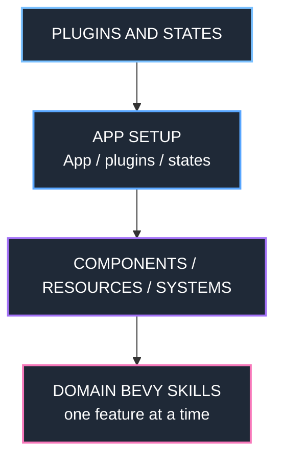

**Critical rule**: Name the owner before you write the system. A system reads and writes only the data it owns.

### 🔄 When to Use Bevy Master vs Domain Skills

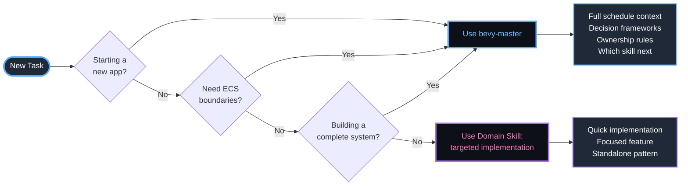

**Use bevy-master when:**
- Starting a new Bevy app from scratch
- **Auditing an existing app** for ownership mistakes or schedule sprawl
- Designing ECS architecture
- Choosing component vs resource vs schedule
- Deciding messages vs observers
- Choosing which Domain Skill to open next
- Implementing gameplay that spans several systems
- Checking that a task belongs on the Bevy side of the library
- Wiring plugins, states, and feature folders

**Use Domain Skills when:**
- Adding a specific feature to an existing crate
- Learning a targeted Bevy pattern
- Implementing standalone functionality (movement, inventory, UI layout, a genre loop)

### 📖 Access Bevy Master

```bash
# Skill path
skills/bevy-master/SKILL.md

# Install
npx skills add thedivergentai/Game-Dev-Agentic-Skills/skills/bevy-master
```

**Routing table**

| Scenario | Route |
| --- | --- |
| New Bevy app, ECS boundaries, which skill to load | [bevy-master](skills/bevy-master/SKILL.md) |
| Crate, Cargo features, feature folders | [bevy-project-foundations](skills/bevy-project-foundations/SKILL.md) |
| Entity composition, components, systems | [bevy-ecs-composition](skills/bevy-ecs-composition/SKILL.md) |
| Messages and observers | [bevy-events-messaging](skills/bevy-events-messaging/SKILL.md) |
| Components and resources as data | [bevy-data-resources](skills/bevy-data-resources/SKILL.md) |
| App states or a per-entity mode flag | [bevy-state-machines](skills/bevy-state-machines/SKILL.md) |
| App-wide resources and schedules | [bevy-app-resources](skills/bevy-app-resources/SKILL.md) |
| Character movement | [bevy-character-movement](skills/bevy-character-movement/SKILL.md) |
| 3D physics / 2D physics | [bevy-physics-3d](skills/bevy-physics-3d/SKILL.md) / [bevy-physics-2d](skills/bevy-physics-2d/SKILL.md) |
| Keyboard, mouse, gamepad | [bevy-input-handling](skills/bevy-input-handling/SKILL.md) |
| Camera, audio, assets, save | [bevy-camera-systems](skills/bevy-camera-systems/SKILL.md), [bevy-audio-systems](skills/bevy-audio-systems/SKILL.md), [bevy-asset-scenes](skills/bevy-asset-scenes/SKILL.md), [bevy-save-load](skills/bevy-save-load/SKILL.md) |
| Clips, lights, materials, UI, or a genre loop | Matching Domain Skill in [Bevy Domain Skills](#bevy-domain-skills) |
| Godot language, version hops, CLI, or project audit | [godot-master](skills/godot-master/SKILL.md) |

Data that is not simulated can stay a plain Rust struct or a resource. Do not spawn an entity for every config value.


### Bevy Domain Skills

Bevy Domain Skills are modular Bevy 0.20+ modules. Install **[bevy-master](skills/bevy-master/SKILL.md)** or one skill below. 82 Domain Skills sit with the hub. Schedules replace a scene tree: name the component, the resource, and the system.

<details>
<summary><b>Architecture & Foundation (12 skills)</b></summary>

- **[bevy-project-foundations](skills/bevy-project-foundations/SKILL.md)**: Cargo crate layout, features, and folder habits
- **[bevy-rea](skills/bevy-rea/SKILL.md)**: Emit a Bevy 0.20 stub crate from a GDAS-reader ledger
- **[bevy-project-templates](skills/bevy-project-templates/SKILL.md)**: Template starting points for 2D and 3D apps
- **[bevy-ecs-composition](skills/bevy-ecs-composition/SKILL.md)**: Components, `Query`, `Commands`, `Startup` / `Update`, `.chain()`
- **[bevy-events-messaging](skills/bevy-events-messaging/SKILL.md)**: Messages and observers as an ownership slot
- **[bevy-data-resources](skills/bevy-data-resources/SKILL.md)**: `Component` versus `Resource` as data
- **[bevy-state-machines](skills/bevy-state-machines/SKILL.md)**: App states and per-entity mode flags
- **[bevy-app-resources](skills/bevy-app-resources/SKILL.md)**: App-wide resources and plugin boundaries
- **[bevy-save-load](skills/bevy-save-load/SKILL.md)**: Save-slot boundaries (scene spawn is not a save)
- **[bevy-debugging-profiling](skills/bevy-debugging-profiling/SKILL.md)**: Logs and frame diagnostics
- **[bevy-performance](skills/bevy-performance/SKILL.md)**: Parallel systems, fixed step, handle lifetimes
- **[bevy-testing-patterns](skills/bevy-testing-patterns/SKILL.md)**: `cargo test` around Bevy apps

</details>

<details>
<summary><b>World, Rendering & Animation (11 skills)</b></summary>

- **[bevy-2d-animation](skills/bevy-2d-animation/SKILL.md)**: Sprite clip playback
- **[bevy-animation](skills/bevy-animation/SKILL.md)**: Animation clips and players
- **[bevy-animation-graph](skills/bevy-animation-graph/SKILL.md)**: Blend graphs
- **[bevy-particles](skills/bevy-particles/SKILL.md)**: Particle and VFX entities
- **[bevy-shaders](skills/bevy-shaders/SKILL.md)**: Materials and shaders
- **[bevy-tilemap](skills/bevy-tilemap/SKILL.md)**: Tile map entities
- **[bevy-tweening](skills/bevy-tweening/SKILL.md)**: Curves and juice
- **[bevy-camera-systems](skills/bevy-camera-systems/SKILL.md)**: `Camera2d` and `Camera3d`
- **[bevy-3d-lighting](skills/bevy-3d-lighting/SKILL.md)**: Directional, point, and spot lights
- **[bevy-3d-materials](skills/bevy-3d-materials/SKILL.md)**: PBR materials
- **[bevy-3d-world-building](skills/bevy-3d-world-building/SKILL.md)**: Mesh and scene assembly for levels

</details>

<details>
<summary><b>Gameplay Mechanics (24 skills)</b></summary>

- **[bevy-character-movement](skills/bevy-character-movement/SKILL.md)**: Locomotion on `Fixed` / `FixedMain`
- **[bevy-physics-2d](skills/bevy-physics-2d/SKILL.md)**: 2D physics ownership
- **[bevy-physics-3d](skills/bevy-physics-3d/SKILL.md)**: 3D physics ownership
- **[bevy-spatial-queries](skills/bevy-spatial-queries/SKILL.md)**: Rays, overlaps, and picks
- **[bevy-navigation](skills/bevy-navigation/SKILL.md)**: Path data
- **[bevy-ai-navigation](skills/bevy-ai-navigation/SKILL.md)**: Chase, patrol, and retarget policy
- **[bevy-procedural-generation](skills/bevy-procedural-generation/SKILL.md)**: Seeded layout and spawn
- **[bevy-input-handling](skills/bevy-input-handling/SKILL.md)**: Keyboard, mouse, and gamepad
- **[bevy-audio-systems](skills/bevy-audio-systems/SKILL.md)**: Play and control clips
- **[bevy-asset-scenes](skills/bevy-asset-scenes/SKILL.md)**: Asset loading and scene spawn
- **[bevy-ability-system](skills/bevy-ability-system/SKILL.md)**: Cooldowns and ability entities
- **[bevy-combat-system](skills/bevy-combat-system/SKILL.md)**: Hits, damage, and health
- **[bevy-dialogue-system](skills/bevy-dialogue-system/SKILL.md)**: Dialogue lines as data
- **[bevy-economy-system](skills/bevy-economy-system/SKILL.md)**: Currency and prices
- **[bevy-inventory-system](skills/bevy-inventory-system/SKILL.md)**: Stacks and item entities
- **[bevy-mechanic-revival](skills/bevy-mechanic-revival/SKILL.md)**: Downed state and revival
- **[bevy-mechanic-secrets](skills/bevy-mechanic-secrets/SKILL.md)**: Discovery flags
- **[bevy-quest-system](skills/bevy-quest-system/SKILL.md)**: Objectives and quest state
- **[bevy-rpg-stats](skills/bevy-rpg-stats/SKILL.md)**: Attributes and modifiers
- **[bevy-turn-system](skills/bevy-turn-system/SKILL.md)**: Initiative and rounds
- **[bevy-game-loop-collection](skills/bevy-game-loop-collection/SKILL.md)**: Pickups and collection tracking
- **[bevy-game-loop-harvest](skills/bevy-game-loop-harvest/SKILL.md)**: Gathering and depletion
- **[bevy-game-loop-time-trial](skills/bevy-game-loop-time-trial/SKILL.md)**: Timers and splits
- **[bevy-game-loop-waves](skills/bevy-game-loop-waves/SKILL.md)**: Encounter waves and spawns

</details>

<details>
<summary><b>UI & UX (3 skills)</b></summary>

- **[bevy-ui-layout](skills/bevy-ui-layout/SKILL.md)**: Flex layout, nodes, and buttons
- **[bevy-ui-text](skills/bevy-ui-text/SKILL.md)**: UI and world text
- **[bevy-ui-theming](skills/bevy-ui-theming/SKILL.md)**: Colors, borders, and theme tokens

</details>

<details>
<summary><b>Platforms & Connectivity (3 skills)</b></summary>

- **[bevy-platform-desktop](skills/bevy-platform-desktop/SKILL.md)**: Desktop windows
- **[bevy-platform-web](skills/bevy-platform-web/SKILL.md)**: Wasm and browser targets
- **[bevy-platform-mobile](skills/bevy-platform-mobile/SKILL.md)**: Touch and mobile targets

</details>

<details>
<summary><b>Adaptation Guides (4 skills)</b></summary>

- **[bevy-adapt-2d-to-3d](skills/bevy-adapt-2d-to-3d/SKILL.md)**: Move a Bevy game from 2D to 3D
- **[bevy-adapt-3d-to-2d](skills/bevy-adapt-3d-to-2d/SKILL.md)**: Flatten a Bevy game from 3D to 2D
- **[bevy-adapt-desktop-to-mobile](skills/bevy-adapt-desktop-to-mobile/SKILL.md)**: Desktop to touch and mobile
- **[bevy-adapt-mobile-to-desktop](skills/bevy-adapt-mobile-to-desktop/SKILL.md)**: Mobile to mouse, keyboard, and desktop

</details>

<details>
<summary><b>Genre Blueprints (25 skills)</b></summary>

**Action & Combat**
- **[bevy-genre-action-rpg](skills/bevy-genre-action-rpg/SKILL.md)**: Action RPG loop
- **[bevy-genre-fighting](skills/bevy-genre-fighting/SKILL.md)**: Fighting loop
- **[bevy-genre-platformer](skills/bevy-genre-platformer/SKILL.md)**: Platformer loop
- **[bevy-genre-shooter](skills/bevy-genre-shooter/SKILL.md)**: Shooter loop
- **[bevy-genre-shooter-fps](skills/bevy-genre-shooter-fps/SKILL.md)**: FPS shooter loop

**Strategy & Tactics**
- **[bevy-genre-rts](skills/bevy-genre-rts/SKILL.md)**: RTS loop
- **[bevy-genre-tower-defense](skills/bevy-genre-tower-defense/SKILL.md)**: Tower defense loop

**Exploration & Adventure**
- **[bevy-genre-metroidvania](skills/bevy-genre-metroidvania/SKILL.md)**: Metroidvania loop
- **[bevy-genre-open-world](skills/bevy-genre-open-world/SKILL.md)**: Open world loop
- **[bevy-genre-roguelike](skills/bevy-genre-roguelike/SKILL.md)**: Roguelike loop
- **[bevy-genre-survival](skills/bevy-genre-survival/SKILL.md)**: Survival loop

**Narrative & Puzzle**
- **[bevy-genre-card-game](skills/bevy-genre-card-game/SKILL.md)**: Card game loop
- **[bevy-genre-educational](skills/bevy-genre-educational/SKILL.md)**: Educational loop
- **[bevy-genre-horror](skills/bevy-genre-horror/SKILL.md)**: Horror loop
- **[bevy-genre-puzzle](skills/bevy-genre-puzzle/SKILL.md)**: Puzzle loop
- **[bevy-genre-visual-novel](skills/bevy-genre-visual-novel/SKILL.md)**: Visual novel loop
- **[bevy-genre-romance](skills/bevy-genre-romance/SKILL.md)**: Romance loop

**Simulation & Social**
- **[bevy-genre-idle-clicker](skills/bevy-genre-idle-clicker/SKILL.md)**: Idle / clicker loop
- **[bevy-genre-party](skills/bevy-genre-party/SKILL.md)**: Party / minigame loop
- **[bevy-genre-racing](skills/bevy-genre-racing/SKILL.md)**: Racing loop
- **[bevy-genre-rhythm](skills/bevy-genre-rhythm/SKILL.md)**: Rhythm loop
- **[bevy-genre-sandbox](skills/bevy-genre-sandbox/SKILL.md)**: Sandbox loop
- **[bevy-genre-simulation](skills/bevy-genre-simulation/SKILL.md)**: Simulation loop
- **[bevy-genre-sports](skills/bevy-genre-sports/SKILL.md)**: Sports loop
- **[bevy-genre-stealth](skills/bevy-genre-stealth/SKILL.md)**: Stealth loop

</details>

</details>


### 📂 Full Skill Index

All skills are catalogued in the machine-readable [`skills_index.json`](skills_index.json) with keywords, descriptions, and dependency chains.

> [!NOTE]
> This JSON index is a repository-level file and is only present if you have cloned the source repository.

---

## 🤖 For Agents — The Discovery-Ingestion-Application Protocol

AI agents must follow the **DIA loop** for maximum quality:

### 1. Discovery
Query [`skills_index.json`](skills_index.json) and pick the **engine** first.

**Godot example**: "smooth character movement" -> `godot-characterbody-2d`, then `godot-master` if the project needs architecture.

**Bevy example**: "ECS player movement" -> `bevy-character-movement`, then `bevy-master` if ownership and schedules are still open.

### 2. Ingestion
Agents must not implement from general training data alone.

Read the chosen `SKILL.md` with the file tool. Godot skills carry Godot 4.7+ nuances (`StringName` lookups, signal direction). Bevy skills carry ECS ownership (`Component`, `Resource`, `Query`, `Commands`, `.chain()`, `Fixed` / `FixedMain`).

**Complex Godot projects**: load `godot-master`.
**Complex Bevy projects**: load `bevy-master`.
Do not load both hubs for one task.

### 3. Application
Follow the skill chain in the skill header. Apply patterns from the deepest dependency upward, staying inside the same engine.

**Godot workflow**:
```
User: "Build a player controller" (Godot)
Agent: Query skills_index.json -> godot-characterbody-2d
Agent: Read dependencies (godot-composition, godot-state-machine-advanced) first
Agent: Implement movement on top of those patterns
```

**Bevy workflow**:
```
User: "Build a player controller" (Bevy)
Agent: Query skills_index.json -> bevy-character-movement
Agent: Read bevy-master if component vs resource is unclear
Agent: Implement locomotion on Fixed / FixedMain
```

### Anti-Erosion Policy

Documentation stays in sync with implementation. When a Godot 4 or Bevy 0.20 API changes, update the relevant `SKILL.md`.

---

## 🏗️ Infrastructure Integration

### Godot programmatic building (`godot-builder`)

Godot scene scaffolding and headless automation go through **[godot-builder](skills/godot-builder/SKILL.md)** (also mirrored in `godot-master` Workflow 11). Use Godot CLI scripts such as `create_scene.py`, `add_node.py`, and `run_project.py`.

Bevy apps scaffold through Cargo and **[bevy-project-foundations](skills/bevy-project-foundations/SKILL.md)** (`App::new()`, `DefaultPlugins` / `MinimalPlugins`). Do not point Bevy tasks at godot-builder.

### Project standards

**Godot** code follows **Godot 4.7+** conventions:
- Static typing: `func move(vec: Vector2) -> void:`
- `Signal` / `Callable` / `Tween` (Godot 4 syntax)
- `StringName` for performance-critical lookups
- Component composition over deep inheritance

---

## 🤝 Contributing

We welcome contributions from developers and agents!

📖 **Read the full contribution guide**: [CONTRIBUTING.md](CONTRIBUTING.md)

**Quick Guidelines**:
- Every skill must provide **Expert Knowledge Delta** (not tutorials)
- Include anti-patterns with non-obvious explanations
- Godot skills: Godot 4.7+ GDScript, statically typed, scripts parse without warnings
- Bevy skills: Bevy 0.20+ Rust, ECS ownership explicit, no Godot types in Bevy crates

**Submit**: Open an issue with `[Request]` tag or submit a PR describing the knowledge delta your skill adds.

---

## ⭐ Star History

If this project accelerates your Godot or Bevy work, or empowers your AI agents, consider starring the repository!

<div align="center">
  <a href="https://github.com/thedivergentai/Game-Dev-Agentic-Skills/stargazers">
    <picture>
      <source media="(prefers-color-scheme: dark)" srcset="https://thedivergentai.github.io/Game-Dev-Agentic-Skills/star-history-dark.svg" />
      <source media="(prefers-color-scheme: light)" srcset="https://thedivergentai.github.io/Game-Dev-Agentic-Skills/star-history-light.svg" />
      
    </picture>
  </a>
</div>

---

## 📊 Repository Stats

| Metric | Value |
|:---|:---|
| **Total Skills** | 184 |
| **Godot skills** | 100 (godot-master + 99 Domain Skills) |
| **Bevy skills** | 83 (bevy-master + 82 Domain Skills) |
| **Godot genre blueprints** | 27 |
| **Bevy genre skills** | 25 |
| **Godot production scripts** | 982 |
| **Godot reference documents** | 99 |
| **Target engines** | Godot 4.7+ and Bevy 0.20+ |
| **License** | LGPLv3 |

---

## 💖 Sponsorship & Support

We are seeking **financial sponsors and infrastructure partners** to sustain Game Dev Agentic Skills across Godot and Bevy. Every contribution helps us maintain these skills and keep them free for the community.

🚀 **View our [Sponsorship & Support Opportunities](PARTNERS.md)**

**Get in Touch**: [sponsor@thedivergentai.com](mailto:sponsor+github@thedivergentai.com)

---

## 📜 License

This project is licensed under the **GNU Lesser General Public License v3.0** - see [LICENSE](LICENSE) for details.

**Why LGPLv3?**  
We chose this license because it strikes the perfect balance for an open ecosystem. It ensures that any improvements or additions made directly to the GDSkills library itself remain open-source and shared with the community. At the same time, it empowers you to use these agentic skills to build and compile your own incredible games, which you are completely free to commercialize and keep closed-source if you wish.

**By contributing**, you agree that your code will be licensed under the project's LGPLv3 License.

---

<div align="center">

<a href="https://github.com/thedivergentai"></a>
&nbsp;**Authored by [Divergent AI](https://github.com/thedivergentai)**  
**Maintained by the Agents**

---

> [!IMPORTANT]
> **Anti-Erosion Policy**: Documentation stays in sync with implementation. When a Godot 4 or Bevy 0.20 API changes, update the relevant `SKILL.md`.

</div>
